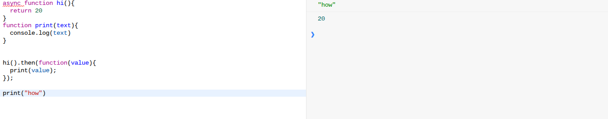

# Entry 1
##### 11/13/2026

Node.js is hard like really hard it makes my skin crawl any time i see code written in it. But you can do lots with it and it is what i will be using my freedom project. The reason its so hard and why i am using it for my freedom project is because that that it can do async computing which is a way for javascript to do 2 operations at once, and that it deals with networking so i can make my server fast.

First let us in depth talk about async computing in js. As said in the last paragraph async computing is a way for js it do multiple things at once. For you more techy people it doesn't use multiple cores it just doesn't stop whatever it was doing because of one operation. Basically the program says ok do this thing i will check back on you to see if it is complete and if it is, it will take out that value and do whatever it needs to do with it.

Some basic code for async and await is 

```
async function hi(){
  return 20
}
function print(text){
  console.log(text)
}


hi().then(function(value){      /*calls hi then says "once your done with that move one to calling"
  print(value);                 and after this statement we can still call new statements that */
});
```


As you can see the task that was called without async got done before the one with async. That's because when the browser or in node.js case runtime is done with a task it waits until js is done with the operation it's doing.

Also i forgot to say that operations that await or async are run on the browser.

Async and await are useful for this project because there are gonna be task that my code has to do that take a long time like reading and looking for files.

Speaking of file lets talk about fs calls which is how node.js looks and edits files. fs is a module of node.js and needs to be called in to make it work (very similar to python) 

`const fs = require('fs');`

this makes it so that we can call the methods that it uses.

```
const fs = require('fs').promises;

async function readFileExample() {
  try {
    const data = await fs.readFile('myfile.txt', 'utf8');
    console.log('File content:', data);
  } catch (err) {                  
    console.error('Error reading file:', err);
  }
}
```

the fs method used in this code snippet is fs.readFile which just looks at the code and reads what the file says from what a text editor would see. and it does this with await and async so that if i were to plop this code into other code it wouldn't slow it down. 

another fs method is fs.write which just makes it easy to write data but all it does is create a new file or replaces an existing file with the data you specified  

```
const fs = require('fs').promises;

async function writeFileExample() {
  try {
    // Write text to a file
    await fs.writeFile('myfile.txt', 'Hello, World!', 'utf8');

    console.log('Files created successfully');
  } catch (err) {
    console.error('Error writing files:', err);
  }
}
```

if there was a file already called myfile.txt with a lot of info it would have been all deleted and replaced with 'Hello, World!' 

If you want to add data at the end of the file you would need the fs mothod fs.appendFile() which just adds data to the end of a file.

```
const fs = require('fs').promises;

async function appendToFile() {
  try {
    
    const text = `Hello, World!`;
    await fs.appendFile('app.log', text, 'utf8');

    console.log('Added text');
  } catch (err) {
    console.error('Error appending to file:', err);
  }
}

appendToFile();
```

also you can see at the end there is a line that says `catch(err)` this is a how you can add errors or error correcting to your code because that line is basically saying if the action up top says an error do this which act be useful for retrying actions.

Next on our list of items that i might need is the http method and maybe https if i really need it. which would help with hosting and getting it on a webpage because right now what i have been describing has been purely backend, we need something for the user to interact with and for the program to respond to. 

[Next](entry02.md)

[Home](../README.md)